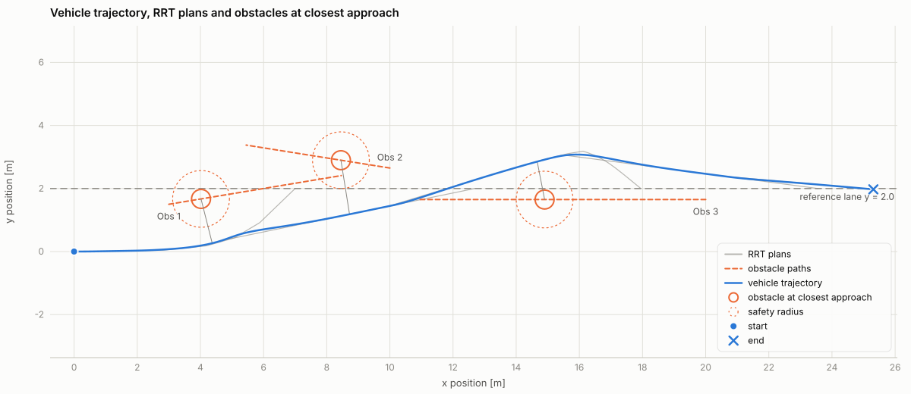

# av_rrt_pid — RRT + PID car obstacle avoidance (C++, ROS 2 Humble, Gazebo Harmonic)

C++ port of the CasADi NMPC dynamic-obstacle-avoidance script, with the NMPC
replaced by an **RRT motion planner** and a **PID path follower**. Same car
(kinematic bicycle, L = 1 m, |δ| ≤ π/10, a ∈ [−2, 2]), same three moving
obstacles, same 0.9 m safety radius, same y = 2 reference lane.



**All code is C++17.** The only non-C++ files are data and configuration:
the launch file (XML — ROS 2 launch files can be Python, XML or YAML, not
C++), the Gazebo world (SDF, generated by a C++ tool), the parameter and
bridge files (YAML) and the RViz view.

## How the Python script maps to this package

| NMPC script (Python)              | Here (C++)                                                        |
|-----------------------------------|-------------------------------------------------------------------|
| `NMPC_solver()`                   | `LocalPlanner` + `RRTPlanner` (path) and `PathFollower` (PID)      |
| `ref_path()` — lane y = 2, N steps| local goal `goal_lookahead` = 8 m ahead on the lane                |
| `predict_obstacle()`              | `Obstacle::predict(t)` — same constant-velocity model             |
| `dynamics()` / `predict_dyn()`    | `bicycleStep()`; in Gazebo: `v += a·dt`, `ω = v·tanδ/L`           |
| `obstacle_dynamics_all()`         | `obstacle_manager_node` → Gazebo VelocityControl                  |
| `build_mujoco_xml(num_obs)`       | `make_world` tool → `world_sdf.cpp` (world from `params.yaml`)    |
| `run_nmpc_simulation()`           | `standalone_sim` (no ROS) or `ros2 launch … sim.launch.xml`       |
| `plot_results()` (matplotlib)     | `plot_results` tool → `svg_plot.hpp` (SVG figures, no dependencies)|

```
av_rrt_pid/
├── include/av_rrt_pid/    types, bicycle_model, rrt_planner, local_planner,
│                          pid_follower, world_sdf (ROS-free)
│                          ros_conversions.hpp (ROS message helpers)
├── src/core/              rrt_planner.cpp, local_planner.cpp, pid_follower.cpp, world_sdf.cpp
├── src/nodes/             obstacle_manager_node, rrt_planner_node, pid_controller_node
├── src/standalone_sim.cpp offline simulation of the same scenario
├── src/tools/             make_world.cpp     world + bridge config from params.yaml
│                          plot_results.cpp   SVG plots from the CSV logs
│                          svg_plot.hpp       small dependency-free SVG plotting helper
├── launch/sim.launch.xml  Gazebo + bridge + nodes + RViz
├── worlds/                av_rrt_world.sdf   (generated by make_world for the default params)
├── config/                params.yaml (every parameter + obstacles), bridge.yaml (generated)
└── rviz/                  RViz view: path, RRT tree, obstacles, safety discs
```

The planner and controller live in a **ROS-free core library**. The ROS nodes
are thin wrappers around it, and `standalone_sim` runs the same classes
without ROS — so you can tune gains in seconds offline and the identical code
runs in Gazebo.

## System

```
                     /obstacles [x,y,vx,vy]*n
 obstacle_manager ───────────────────────────────▶ rrt_planner ──/planned_path──▶ pid_controller
   │        ▲                                          ▲                              │    ▲
   │cmd_vel │odometry                                  │ /model/car/odometry          │    │
   ▼        │                                          │                     cmd_vel  ▼    │
 ┌────────────────────────── Gazebo Harmonic (via ros_gz_bridge) ───────────────────────────┐
 │  obs_j: VelocityControl + OdometryPublisher      car: VelocityControl + OdometryPublisher │
 └───────────────────────────────────────────────────────────────────────────────────────────┘
```

* **pid_controller** turns `[a, δ]` into a Gazebo command with your bicycle
  model: `v_cmd ← v_cmd + a·dt`, `ω = v_cmd·tan(δ)/L`. Gazebo's VelocityControl
  applies it and OdometryPublisher reports the pose back, so the loop is closed
  through the simulator.
* The car and obstacles are **velocity-controlled kinematic bodies** (like the
  MuJoCo replay, where the bicycle model set the body pose). The world has
  **zero gravity** so they don't sink between velocity updates; nothing else in
  the scene needs it.
* The planner and controller run on **sim time**, triggered by odometry stamps
  (5 Hz and 10 Hz, dt = 0.1 like the script), so they stay in step with Gazebo
  even if it runs slower than real time.
* Obstacles wait until the first path is published, so the car and obstacles
  start together, like t = 0 in the Python simulation.

## The planner: time-aware, turn-radius-aware RRT

1. **Moving obstacles.** Each tree node is time-stamped with when the car
   would reach it (accelerating from its current speed to `cruise_speed`).
   Edges are collision-checked against each obstacle's *predicted* position at
   that time — the same constant-velocity prediction the NMPC constraints used.
2. **The car can't turn on the spot.** Plain RRT produces corners the car
   cannot drive (R_min = L / tan(π/10) ≈ 3.08 m). A corner of angle θ between
   segments l₁, l₂ is only allowed if an arc of R_min fits:
   `R_min · tan(θ/2) ≤ min(l₁, l₂) / 2`. Tree growth rotates new edges into
   that cone, and shortcutting respects it too. This was the single biggest
   improvement in testing (it removed every near-collision).
3. **Receding horizon.** Like the NMPC's 6 s horizon, it plans to a local goal
   8 m ahead on the lane (slid along the lane if that spot will be occupied),
   and **replans only when needed**: no path, a predicted collision on the
   remaining path, the car > 1 m off the path, or < 3 m of path left.
   Replanning every cycle would make the random tree flip sides around obstacles.
4. **Post-processing.** Greedy shortcutting, then Chaikin corner-cutting kept
   only if still collision-free. If the exact goal is unreachable it returns the
   branch that gets closest (with ≥ 2 m progress) and replans later.
5. **Hysteresis.** Plans use the 0.9 m radius + 0.3 m inflation; the
   "is my path still safe?" check uses the true 0.9 m, so small tracking errors
   don't trigger constant replanning.

## The controller: two PID loops

| loop    | error                                   | output | bound          |
|---------|-----------------------------------------|--------|----------------|
| speed   | `v_target − v`                          | `a`    | [−2, 2] m/s²   |
| heading | bearing to lookahead point − ψ          | `δ`    | ±π/10, 1.5 rad/s rate |

* Lookahead `Ld = 0.8 + 0.3·v` m along the path from the car's closest point.
* `v_target` = cruise speed, reduced for large heading errors and near the goal
  (`v ≤ √(2·a_brake·d)`).
* **Derivative on measurement** (D acts on −dψ/dt, −dv/dt, not on the error),
  so a new path doesn't cause a derivative kick; conditional-integration
  anti-windup.
* **kd = 0 by default, on purpose.** In the kinematic bicycle model both plants
  are integrators that respond instantly to the input (v̇ = a, ψ̇ = v·tanδ/L).
  A D-term on yaw rate just feeds back the previous steering command and makes
  δ chatter step-to-step — I saw exactly that in testing. P + I does the work;
  the D gains are there to experiment with.

## Install and build

You already have ROS 2 Humble and Gazebo Harmonic (from PX4). The ROS ↔ Gazebo
bridge for that pairing is a separate package from the OSRF apt repository
(the same repository Gazebo Harmonic came from):

```bash
sudo apt install ros-humble-ros-gzharmonic
```

Note: it **conflicts with `ros-humble-ros-gz*`** (the Fortress-based bridge),
so apt will remove those if installed. Gazebo's docs list Humble + Harmonic as
possible but not the official pairing — see
[Installing Gazebo with ROS](https://gazebosim.org/docs/all/ros_installation).

```bash
mkdir -p ~/av_ws/src && cd ~/av_ws/src
unzip ~/Downloads/av_rrt_pid.zip
cd ~/av_ws
source /opt/ros/humble/setup.bash
colcon build --symlink-install --packages-select av_rrt_pid
source install/setup.bash
```

## Run

**1. Offline first (no ROS, no Gazebo)** — same scenario, CSV + plots:

```bash
ros2 run av_rrt_pid standalone_sim --seed 1 --out /tmp/sim
ros2 run av_rrt_pid plot_results /tmp/sim      # -> /tmp/sim_*.svg, open in a browser
```

Tuning flags: `--cruise --inflation --lookahead --lookahead-gain --kp-heading
--kd-heading --kp-speed --steer-rate --v0 --tmax`. Run a few seeds — RRT is
random, so judge settings over many runs, not one.

**2. Gazebo + RViz:**

```bash
ros2 launch av_rrt_pid sim.launch.xml           # rviz:=false to skip RViz
```

Gazebo starts **paused** so you can see the car at the start: press ▶ (bottom
left of the Gazebo window) when you're ready. To keep the camera on the car,
open the Entity Tree (top-right ⋮ menu → *Entity Tree* if it isn't shown),
right-click `car` → *Follow*. `paused:=false` starts the run immediately.
RViz shows the planned path (orange), RRT tree (grey), local goal, obstacles and
their safety discs.

**3. Plot the Gazebo run** (logs are written to `/tmp/av_rrt_pid_run_*.csv`):

```bash
ros2 run av_rrt_pid plot_results /tmp/av_rrt_pid_run
```

Four SVG figures: control inputs with their limits, speed vs. target and yaw,
centre distance to each obstacle vs. the safety radius (closest approach
labelled), and the x–y trajectory with every RRT plan and each obstacle at
its closest approach. Hover a line or marker in the browser for details.
The tool also prints the closest approach to each obstacle.

## Changing the scenario

Everything is in `config/params.yaml`. Obstacles are the flattened `obs_states`
array under `/**`. The nodes read it at start-up; the Gazebo world and the
bridge topics come from the `make_world` tool, which reads the same file
(the shipped `worlds/av_rrt_world.sdf` and `config/bridge.yaml` were
generated by it for the default scenario):

```bash
P=~/av_ws/src/av_rrt_pid/config/params.yaml
ros2 run av_rrt_pid make_world --ros-args --params-file $P -p output_dir:=$HOME/av_sim
ros2 launch av_rrt_pid sim.launch.xml params:=$P \
    world:=$HOME/av_sim/av_rrt_world.sdf bridge_config:=$HOME/av_sim/bridge.yaml
```

With `--symlink-install` the installed `params.yaml` is your source file, so
`params:=` can be left out. Write every float with a decimal point (`25.0`,
not `25`): ROS 2 rejects an integer where a double parameter is declared.

## Results (offline, 100 random seeds each)

| setup                                     | goal reached | closest approach* | time  |
|-------------------------------------------|-------------|-------------------|-------|
| defaults (cruise 1.5 m/s, start at rest)  | 100 / 100   | 1.01 m            | 18.3 s|
| + 1-step actuation delay + odometry noise | 100 / 100   | 1.04 m            | 18.4 s|
| start at 2 m/s (as in the NMPC script)    | 100 / 100   | 1.04 m            | 18.1 s|
| cruise 2.0 m/s                            | 100 / 100   | 0.88 m            | 14.4 s|

\* Minimum centre-to-centre distance over all runs and obstacles.
Safety radius 0.9 m; contact at 0.5 m. At the default speed the car never
entered a safety disc. At 2 m/s two runs dipped briefly to 0.88 m; raise
`plan_inflation` if you run faster.

## Status and known limitations

* **Tested:** the core (planner + controller) in the offline simulator as
  above; `plot_results` end to end; the whole CMake build and install against
  stand-in ROS packages (nodes compile warning-free); `make_world`'s SDF is
  well-formed. **I could not run ROS 2 or Gazebo in my environment**, so the
  first Gazebo launch is the first real end-to-end run — if something is off
  it will most likely be in the bridge or plugin setup (see Troubleshooting),
  not in the planning/control logic.
* Front wheels don't visually steer (single-link car; steering joints would be
  needed). The motion itself follows the bicycle model exactly.
* Obstacle velocities are given to the planner as ground truth, as in the
  NMPC script. With sensors you'd feed `/obstacles` from a tracker instead.
* RRT is not optimal. RRT* (rewiring) is the natural upgrade.

## Troubleshooting

* **Nothing moves / planner says "Waiting for /obstacles":** check the bridge.
  `gz topic -l` should list `/model/car/odometry`; `ros2 topic hz
  /model/car/odometry` should show ~50 Hz. If Gazebo has the topic but ROS
  doesn't, the installed bridge is the Fortress one → install
  `ros-humble-ros-gzharmonic`.
* **"Failed to load system plugin gz-sim-…":** you are running Fortress
  (`ign gazebo`). In `src/core/world_sdf.cpp` rename `gz-sim-X-system` →
  `ignition-gazebo-X-system`, `gz::sim::systems::` → `ignition::gazebo::systems::`
  and `gz.msgs.` → `ignition.msgs.`, rebuild, run `make_world`, and change
  `gz sim` to `ign gazebo` in `sim.launch.xml`.
* **Bridge complains about the config file:** check
  `ros2 run ros_gz_bridge parameter_bridge --ros-args -p config_file:=<bridge.yaml>`
  on its own; old ros_gz releases used `ign_` instead of `gz_` keys.
* **`InvalidParameterTypeException` at start-up:** an integer was written
  where a double is expected in `params.yaml`.
* **Car is late compared to the plan:** it's fine for the car to lag a little —
  the planner re-checks the remaining path against fresh predictions every
  0.2 s and replans if a conflict appears.

## Extending to multiple cars

`/obstacles` is the interface: any moving thing the planner should avoid is a
row `[x, y, vx, vy]`. For multi-robot planning, run one planner/controller pair
per car (in its own namespace) and have each car's shared position and velocity
appended to the other cars' `/obstacles`.
